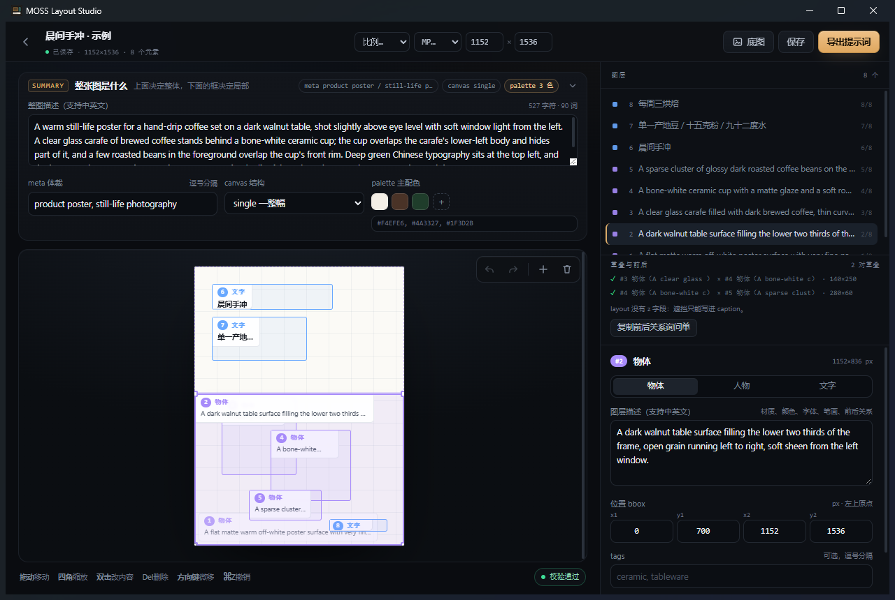

# MOSS Layout Studio

把「JSON + bbox」的布局提示词变成一张**能看、能拖、能导出**的画布：新建 / 导入 / 拖框 / 改文案 / 自动保存 / 校验 / 导出，草稿存在本地 SQLite 里，关掉也不丢。

两种形态，同一套界面：

- **桌面软件**：`MOSS-Layout-Studio.exe` 双击打开一个原生窗口。不用装 Python，不弹浏览器，没有控制台黑框。
- **本地服务**：`python3 server.py` 起一个本地网页。同一套 REST API 也可以被脚本 / ComfyUI 节点直接调用。



## 功能

| 操作 | 说明 |
| --- | --- |
| 列表 | 缩略图、名称、尺寸、元素数、更新时间；按更新时间倒序 |
| 搜索 | 按名称或整图描述过滤，`/` 快速聚焦搜索框 |
| 新建 | 选比例（1:1 / 3:4 / 9:16 / 21:9 / 1:8…）和目标像素，自动算 16 倍数分辨率 |
| 导入 | 草稿 JSON、编译稿（自动换算中心原点）、纯 caption；旧的 `.notes.json` 也能一起选，中文并进图层描述 |
| 复制提示词 | 不打开画布，直接把编译好的 MOSS 提示词放进剪贴板 |
| 自动保存 | 改动 0.9 秒后写回；`⌘S` / `Ctrl+S` 立即保存 |
| 冲突处理 | 两个窗口同时改同一份时，服务端用 `rev` 拦住，前端提示覆盖或放弃 |

画布上：

| 操作 | 效果 |
| --- | --- |
| 拖框体 / 拖四角 | 移动 / 缩放，自动裁进画布 |
| 双击框 | 跳到对应的文字或描述字段 |
| `Del` / `Backspace` | 删除选中元素 |
| 方向键 | 微移 1px，`Shift` 为 10px |
| `⌘Z` / `⇧⌘Z` | 撤销 / 重做（拖拽、字段编辑、调层级都可撤销） |
| `↑` `↓` | 调数组顺序（只影响编辑器图层，layout 规范没有 z 字段） |
| 比例 / MP | 等比缩放画布和所有框 |
| 底图 | 上传一张出图叠在框下面，用来核对坐标，不参与导出 |
| 右侧面板 | 图层、重叠检测、字段检查器、对齐（居中 / 铺满） |
| 重叠询问单 | 框重叠时一键复制「谁在前 / 谁在后」的询问单，交给 skill 写遮挡句 |

整图和一个图层都只有一个描述字段（`caption`），**中英文都写在这里**，不再分「英文 caption / 中文参考」。新增图层只给几何位置，不会预填任何文案。

## 安装与运行

### Windows 桌面版（推荐）

到 [Releases](https://github.com/Le-dawn/moss-layout-studio/releases) 下载 `MOSS-Layout-Studio.exe`，双击即可。

- 单文件，约 12 MB，GUI 程序：没有控制台窗口，没有地址栏，不弹浏览器标签页。
- 再双击一次不会开第二个实例，直接把已有窗口调到前台。
- 「下载」走系统「另存为」对话框；「复制」走系统剪贴板。
- 数据在 `%LOCALAPPDATA%\MossLayoutStudio\data\`（`app.db` + `uploads/`），日志在同目录 `logs\app.log`。
- 需要 Microsoft Edge WebView2 运行时（Win10/11 基本都自带；真缺了启动会提示并给下载链接）。
- 未签名，首次运行 SmartScreen 可能拦一下：更多信息 → 仍要运行。

### 从源码跑本地服务

```bash
python3 server.py                    # http://127.0.0.1:8480
python3 server.py --port 9000        # 换端口
python3 server.py --host 0.0.0.0     # 局域网访问（无鉴权，别直接暴露公网）
python3 server.py --data ./mydata    # 换数据目录
```

零第三方依赖：Python 3.10+ 标准库 + SQLite。第一次启动会自动创建 `data/app.db` 和 `data/uploads/`。

打开页面后可以点「载入示例」，或「导入 JSON」把已有的草稿 / 编译稿塞进来。

## 从源码打包 exe

打包需要 PyInstaller + pywebview + pythonnet（`packaging/requirements-build.txt`），运行本身不需要。

```powershell
# Windows 本机
powershell -ExecutionPolicy Bypass -File packaging\build_exe.ps1
```

```bash
# 在 WSL 里交叉打 Windows exe（用 Windows 版 Python + PyInstaller）
packaging/build_exe.sh
WIN_PY='D:\software\python\python.exe' packaging/build_exe.sh   # 指定解释器
```

产物：`dist/MOSS-Layout-Studio.exe`。打包相关文件都在 [`packaging/`](packaging/)：

| 文件 | 作用 |
| --- | --- |
| `moss-layout-studio.spec` | PyInstaller 配置：单文件、GUI、带 `web/` + `assets/`、内嵌图标和版本信息 |
| `build_exe.ps1` / `build_exe.sh` | 一键脚本（Windows / WSL），自动建 `.build/venv` 并装依赖 |
| `make_icon.py` | 纯标准库画 `icon.ico`（深色画布 + 三块布局框），改颜色直接重跑 |
| `version_info.txt` | exe 属性里的产品名 / 版本号 |
| `requirements-build.txt` | 打包依赖 |

桌面版入口是 [`desktop.py`](desktop.py)：pywebview 窗口 + 单实例 + 原生另存为 / 剪贴板桥。窗口里的页面通过 `127.0.0.1` 上一个**系统临时分配**的端口访问后端，只给这个窗口用，进程退出即销毁，不占固定端口。

## 导出

| 格式 | 内容 |
| --- | --- |
| **MOSS 提示词** | 单行 JSON，`abs_centralized` + `yxyx` 中心原点，直接贴 `CLIPTextEncode` |
| **草稿 JSON** | `abs` + `xyxy` + `width/height`，可被本服务和官方 `canvas.py` 原样读回 |
| **Klein 编辑稿** | 指令段 + `{id, from, src_bbox, tgt_bbox, desc}` 表，`0–1000` 左上原点 `[y,x,y,x]`，文字框留 8 单位 |

MOSS 编译逻辑逐条对齐官方 `compile_moss.py`：先 floor 左上、ceil 右下，再各减半个画布。Klein 的 id 生成、坐标换算、`src_bbox` / `tgt_bbox` 规则对齐 `to_klein.py`，多行文字在 `desc` 里压成空格。

导出前会校验，有错误就不编译，不静默放过：

- 画布宽高必须是 16 的正整数倍
- bbox 必须为正、不能越界
- 整图描述不能为空
- `text` 类型必须有逐字内容
- 重叠框有没有写前后关系（提醒）
- 文字框是否太矮 / 单块字太多（提醒）
- 有没有铺满全画布的 background item（提醒）

## REST API

服务端同时是一套无状态编译 API，页面只是它的客户端。

| 方法 | 路径 | 说明 |
| --- | --- | --- |
| `GET` | `/api/layouts` | 列表 |
| `POST` | `/api/layouts` | 新建 `{name, width, height}` 或 `{name, doc}` |
| `GET` | `/api/layouts/{id}` | 读取 |
| `PUT` | `/api/layouts/{id}` | 保存 `{doc, rev, force?}`；`rev` 不一致返回 409 |
| `DELETE` | `/api/layouts/{id}` | 删除 |
| `POST` | `/api/layouts/{id}/duplicate` | 复制一份 |
| `POST` | `/api/layouts/{id}/image` | 上传底图 `{data_url, name}` |
| `DELETE` | `/api/layouts/{id}/image` | 移除底图 |
| `POST` | `/api/import` | 导入 `{name, json, width?, height?}` |
| `POST` | `/api/compile` | 编译 `{doc, klein?}` → MOSS / 草稿 / Klein + 校验 |
| `GET` | `/api/example` | 示例草稿 |
| `GET` | `/api/health` | 健康检查（带数据目录） |

```bash
# 编译（doc 也可以从 GET /api/layouts/{id} 取）
curl -s -X POST http://127.0.0.1:8480/api/compile \
  -H 'Content-Type: application/json' \
  -d '{"doc":{"width":1024,"height":1024,"summary":{"caption":"A warm poster."},"items":[{"label":"object","caption":"A matte paper background.","bbox":[0,0,1024,1024]}]}}' \
  | python3 -m json.tool
```

`POST /api/compile` 不依赖数据库，可以把草稿发给它拿到编译结果；Klein 参数为
`{"task":"edit","refs":1,"instruction":"…","from_map":{"0":"ref_image_0"},"text_margin":8}`。

## 数据与备份

```
%LOCALAPPDATA%\MossLayoutStudio\   # exe 版
data/                              # 源码版
  app.db          SQLite，一份 layout 一行
  uploads/        底图文件
```

- `doc` 只存官方认的字段（`caption` / `meta` / `canvas` / `palette` / `items`）；描述只有一个字段，中英文都写在里面。
- `rev` 是乐观锁版本号，每次保存文档 +1。
- 备份直接拷整个数据目录即可。
- 老版本存过的中文参考（`notes` 列）会在启动时一次性并进 `caption`，不会丢内容。

## 目录

```
desktop.py         桌面入口（pywebview + WebView2、单实例、原生另存为）
server.py          HTTP 服务 + 路由（源码 / 浏览器模式）
moss/spec.py       归一化 / 校验 / MOSS 编译 / Klein 导出
moss/store.py      SQLite
web/               前端（原生 ES modules，无构建）
assets/            示例草稿
packaging/         PyInstaller spec、构建脚本、图标、版本信息
docs/              截图
```

## 它不做什么

- 不出图，不调用任何模型接口。
- layout 规范没有 z 字段：前后关系只能写进 `caption`；数组顺序只是编辑器里的图层语义。
- 改画布尺寸会等比缩放所有框，这是编辑器行为；导出坐标仍是绝对像素。
- 没有登录和多用户权限。默认只监听 `127.0.0.1`，要开给局域网请自己加反向代理和鉴权。

## 参考项目

本项目参考 [swan7-py/json-prompt-visualizer](https://github.com/swan7-py/json-prompt-visualizer)，参考项目是一个 skill，本项目转为直接打包成 exe，也可以用 python 启动服务在网页上操作。

原项目的单文件画布（`canvas.py`）与本项目的编译 / 导出规则对齐；原始版权归原作者所有，见 [LICENSE](LICENSE)。

## License

MIT。原始单文件画布与编译/导出规则的版权归 [swan7-py/json-prompt-visualizer](https://github.com/swan7-py/json-prompt-visualizer) 作者所有，见 `LICENSE`。
